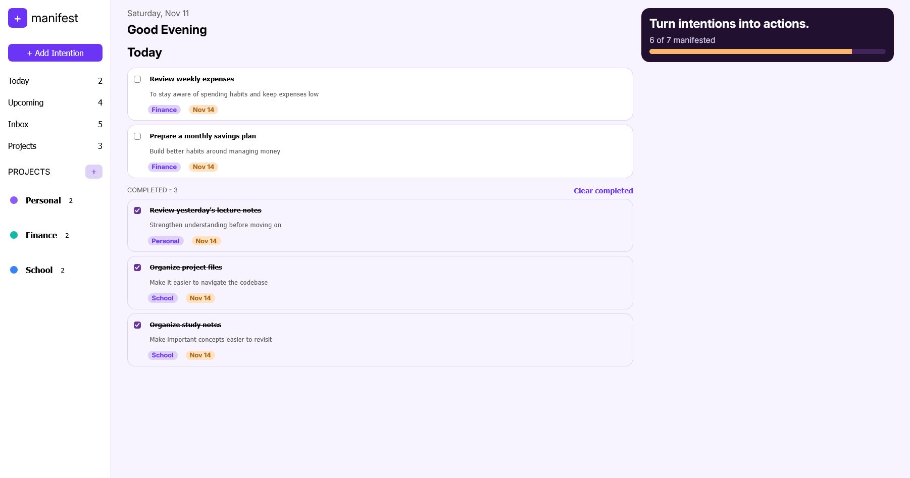
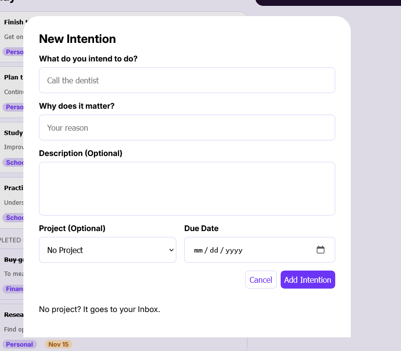
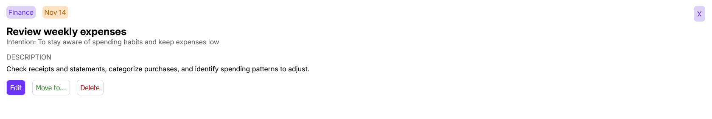
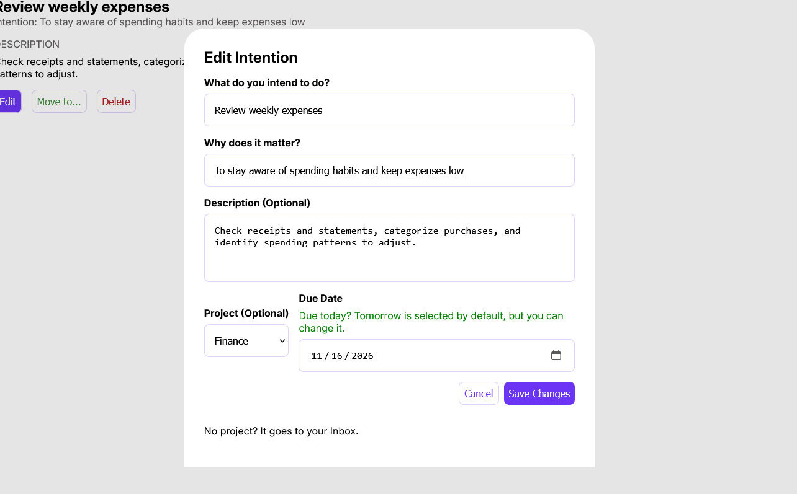
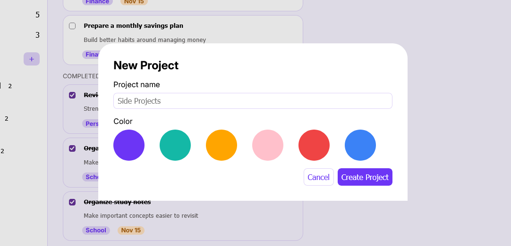
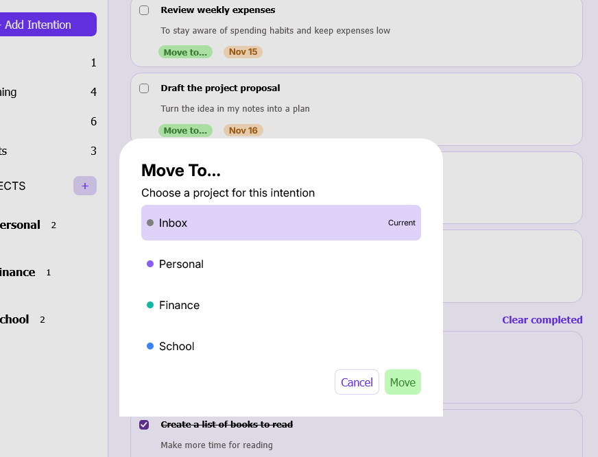
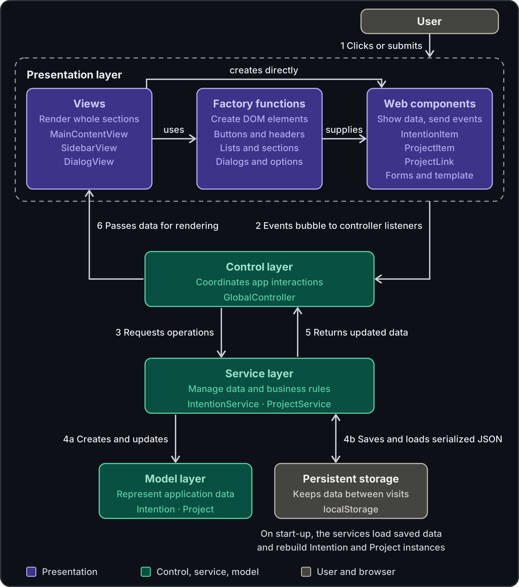

# 📝 Manifest


A personal task management application built as part of <a href="https://www.theodinproject.com/" alt="The Odin Project">The Odin Project</a> curriculum.

## 📚 About The Project

Manifest is a task management application built with JavaScript, Web Components, and the MVCS architecture. Users can organize intentions into projects, schedule due dates, track progress and manage the work through Today, Upcoming, Inbox, General Project and Individual project pages. 

The goal of this project was to practice application architecture, state management, and Web Components while developing with vanilla JavaScript.








### ✨ Features 

A list of features you can perform with Manifest.

- Create, edit, and delete intentions
- Organize intentions into projects
- Move intentions between projects and the Inbox
- Mark intentions as active or completed
- View detailed intention information
- View intentions through Today, Upcoming, Inbox, Projects, and Individual Project pages
- Create and delete projects
- Assign color-coded project markers
- Display daily progress toward intention goals
- Persist application data using localStorage

### 📁 Project Structure

```text
Manifest/
├─ public/
│  ├─ assets/
│  └─ css/
├─ src/
│  ├─ controllers/
│  │  └─ GlobalController.js
│  ├─ models/
│  │  ├─ intention.js
│  │  └─ projects.js
│  ├─ services/
│  │  ├─ IntentionService.js
│  │  └─ ProjectService.js
│  ├─ utils/
│  │  └─ date.js
│  ├─ views/
│  │  ├─ main/
│  │  │  ├─ MainContentView.js
│  │  │  ├─ components/
│  │  │  └─ factories/
│  │  ├─ sidebar/
│  │  │  ├─ SideBarView.js
│  │  │  └─ components/
│  │  └─ forms/
│  │     ├─ DialogView.js
│  │     ├─ components/
│  │     └─ factories/
│  ├─ starterData.js
│  └─ index.js
├─ README.md
└─ package.json
```

The project is organized into dedicated directories for managing application data, handling business logic, utility functions and rendering the UI. The views directory is further divided into page views, custom elements and factory functions.

### 🏗️ Application Architecture

Manifest follows the Model-View-Controller-Service (MVCS) architecture to separate the data management, application logic and UI responsibilities. 


               
**Architecture Sections**

- **Models:** Represent the application's data and define its structure.
- **Views:**  Assemble pages, dialogs, and larger UI sections.
- **Controller:** Coordinate interactions between views and services by responding to user actions and updating the UI.
- **Services:** Manage application data, enforce business rules, and handle operations such as creating, updating, deleting, and retrieving data.
- **Custom Elements:**  Encapsulate reusable interactive UI components such as forms, intention items, and project items.
- **Factory Functions:** Generate reusable DOM structures shared across views and components.

**Data Initialization**

The application uses starter data to populate intentions and projects on first launch.

When the application starts, each service checks `localStorage` for previously saved data. If no saved data exists, the service loads its starter data and persists it to `localStorage`. On later launches, the saved JSON data is loaded and reconstructed into `Intention` and `Project` model instances.

This approach provides example data for the first time use while ensuring user created data persists between sessions.

> [!NOTE]
> The starter data intentionally includes intentions with different creation and due dates so the Today, Upcoming, Inbox, and Project views contain meaningful data on first launch.

## 📦 Getting Started

### 🧰 Prerequisites

Before running the project locally, make sure you have the following installed:
- **Node.js** - ideally the latest LTS version
- **npm** - bundled with *Node.js*
- **Git** - only if you plan to clone the repository

### 📋 Instructions

1. Clone the repo

```
git clone https://github.com/Sivil07/REPOSITORY-NAME.git
```

2. Enter the directory

```
cd REPOSITORY-NAME
```

3. Install the dependencies

```
npm install
```

4. Start the WebPack dev server 

```
npx webpack serve
```

5. Visit the site in your browser

```
http://localhost:8080
```

### ⌨️ Available Scripts

A list of commands you can perform.

<table>
  <thead>
    <tr>
      <th width="500px">Script</th>
      <th width="500px">What it does</th>
    </tr>
  </thead>
  <tbody>
    <tr>
      <td><code>npm run start</code></td>
      <td>Starts the development server and opens the application in the browser.</td>
    </tr>
    <tr>
      <td><code>npm run build</code></td>
      <td>Generates an optimized production build in <code>dist/</code>.</td>
    </tr>
  </tbody>
</table>

## 🚀 Deployment

> [!NOTE]
> These steps are only needed if you want to deploy your own version of the project to GitHub Pages. If you're just running the project locally, you can ignore this section.

This project deploys to GitHub Pages from a `gh-page` branch and built from the bundled `dist/` directory.

**First Deployment only** - create the deployment branch:

```
git branch gh-pages
```

Every deployment or redeployment show follow these steps:

1. Make sure all your work is committed. `git status` will show anything pending
2. Switch to `gh-pages` and sync it with `main`

```
git checkout gh-pages && git merge main --no-edit
```
3. Bundle the application into `dist/`

```
npx webpack
```

4. Commit `dist` contents and push to `gh-pages` branch:

```
git add dist -f && git commit -m "Deployment commit"
git subtree push --prefix dist origin gh-pages
git checkout main
```
5. In the repository's settings, set the GitHub pages source branch to `gh-pages` and that's about it. 

## 🙏 Acknowledgements

- <a href="https://claude.ai/login" alt="Claude">Claude</a> - Assisted with creating the MVCS architecture diagram.

